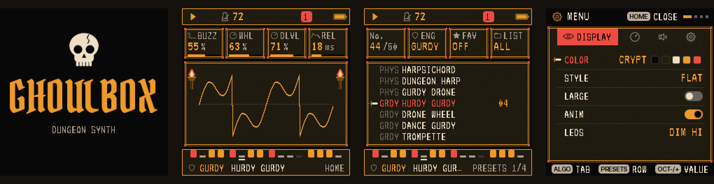

# GHOULBOX: FM-1 Dungeon Synth



**GHOULBOX** is dungeon-synth firmware for the **M-VAVE FM-1**: a fork of
[Felucca](https://github.com/hugelton/Felucca) by Hügelton Instruments (1.4.1), tuned for dark ambient,
medieval and fantasy synth music, from Old Tower and Hole Dweller to Mortiis-era dungeon synth.

**Latest: 2.3.1.** [Play it in your browser](https://ghoulbox.messy.quest/) ·
[install it](https://ghoulbox.messy.quest/webapp/installer/) ·
[hear every sound](https://ghoulbox.messy.quest/sounds/) ·
[watch DREAM, new in 2.3](https://youtu.be/LOAOYNm40zo) ·
[learn it in five video lessons](https://www.youtube.com/playlist?list=PLMUs0QD7QfOw) ·
[read the guide (PDF)](docs/guide/GHOULBOX-User-Guide-2.3.pdf)

GHOULBOX is free and always will be. To support it: [Ko-fi](https://ko-fi.com/ghoulbox) · [merch](https://ghoulbox-shop.fourthwall.com/).

## What's new

### 2.3.1

- **A DREAM fix.** With EVOL on, a project loaded after a dream could be changed using the earlier dream's key and
  parts. DREAM now starts again from what the loaded project's tracks hold (and after a sound change, from the new
  sound).
- **The web editor's groups are back.** Since 1.2 the editor showed GHOULBOX's controls as one long list; it now
  shows them grouped again (Sound, Sequencer, Settings), with RING, KEYS and DREAM.

### 2.3

- **DREAM: let the FM-1 compose** ([watch it](https://youtu.be/LOAOYNm40zo)). Tap HOME on HOME until DREAM (after MIXER, CLOCK and KEYS), choose a MOOD,
  and press a key: the FM-1 writes a slow piece in that key for your four tracks and plays it. Each track gets a
  part that suits its sound: a drone holds the key note, a pad or choir holds the chords, a harp or lute breaks
  them, a melodic sound sings a phrase and answers it, drums play a slow ritual. Turn **EVOL** on and the piece
  keeps changing by itself: a new chord, a new phrase, a part resting or coming back. **DENS** sets how busy it
  is, **DRFT** how often it changes. What it writes is ordinary patterns: play along in key, edit, save.
  It replaces all four tracks' patterns (it asks first).
- **RING: drones through the rests.** On a real hurdy-gurdy the drones sound as long as the wheel turns. A new
  RING page (EDIT, after DRONE and WHEEL) on GURDY tracks keeps the drones sounding when the sequencer reaches a
  rest; they stop when you stop. On for HURDY GURDY, DRONE WHEEL and BAGPIPE. From an owner's request.

Projects saved with 2.3 show as EMPTY on older firmware. Your saved projects, user presets and settings load as
before (RING off, so they sound as they did).

### 2.2

- **Room to grow.** The firmware's free space went from 4.5 KB to 23.8 KB: the artwork and button labels are
  stored compressed (they look exactly the same) and the FM6 engine uses a smaller, more precise table (it
  sounds the same).
- **USB audio is 44.1 kHz only.** Computers convert on their own; a DAW using the FM-1 directly as its audio
  interface needs a 44.1 kHz project.

### 2.1

- **Two sounds at once.** A new KEYS page (tap HOME on HOME: MIXER, CLOCK, KEYS) plays two tracks from the keys:
  **LAYER** stacks them on every key (a recorder doubled by strings), **SPLIT** divides the keyboard (a drone or bass
  in the left hand, the tune in the right). Pick the second track, the split point and its octave; saved with
  the project.
- **Note and chord names.** While you play, the top of the screen names what you're playing: D4, Dm, A7, Gsus4,
  C/E. Turn it off in MENU > CONTROL > NOTE NAMES.
- **Your music comes back at power-on.** RESTORE LAST is ON again, so the FM-1 wakes up with what you were playing
  (stop for a few seconds before switching off). A new FM-1 still starts with the power-on scene; set RESTORE LAST
  to OFF to have the scene every time. Updating switches it ON once; your choice is kept after that.

### 2.0

- **Built on Felucca 1.4.1** (it was 1.0.5.2), with everything Felucca has added since: see
  [Felucca's releases](https://github.com/hugelton/Felucca/releases).
- **12 voices** shared by the four tracks (it was 8), so chords on one track cut fewer notes on another.
- **Drone latch.** Hold GLO and press F#4, G#4, A#4 or C#5 (the top-row keys labelled OP6, PIT, GLO, MONO)
  to latch tracks 1–4: a chord you play keeps sounding after you let go, and other tracks can't steal its
  voices. A new chord replaces it; pressing one of its notes stops it.
- **Turn the hurdy-gurdy's crank.** Set GURDY's COUP to CRANK and the SELECT knob becomes the wheel: the
  faster you turn, the louder and brighter; a flick of the wrist kicks the trompette's buzz.
- **Medieval tunings.** TEMP (SCL > CHORD) tunes a track in Pythagorean, meantone or just intonation from
  its ROOT, for pure fifths and drones that ring without beating.
- **Cave ambience.** AMB and CRKL (FX > TAPE) lay a low cave wind and a torch's crackle under the music,
  with no track and no voice used. Off by default.
- **Three dungeon scales**: Phrygian dominant, Hungarian minor and double harmonic.
- **A USB rescue.** If GHOULBOX fails to start twice in a row, or you hold OCT- while switching on, the FM-1
  starts in a rescue mode with no sound and no menu, where the installer still works.
- **Play it in your browser** at [ghoulbox.messy.quest](https://ghoulbox.messy.quest): the same firmware on a
  drawn FM-1, played with the mouse, computer keys or MIDI, before you install anything. The web synth can
  save and move its complete state, focus the display, and record a performance locally as FLAC, MP3 or
  24-bit stereo WAV.
- **A [demo of what's new](https://youtu.be/NMSw1_wnCwQ)**, rendered by the firmware's own sound and screen
  code: the cave, the latch, the crank, the tunings and the scales.

Your saved projects, user presets and settings load as before.

### 1.4

- **Power-on scenes.** Hold HOME for the menu and pick **SYSTEM > SCENE** to choose what the FM-1 plays
  when you switch it on:

  | Scene | What plays |
  |---|---|
  | **DUNGEON** | The default: hurdy-gurdy, crypt pad, monks, drone. 72 BPM. |
  | **CRYPT** | Low drone, crypt choir, cave wind, slow tomb drums. 60 BPM. |
  | **TAVERN** | Dance gurdy, harp arpeggio, lute, a light drum kit. 96 BPM. |
  | **CHAPEL** | Cathedral organ, monks, a recorder lament, the vielle. 66 BPM. |
  | **BLANK** | DUNGEON's four sounds with no notes, for starting from nothing. |

  The web editor's Settings tab has it too.
- **A hurdy-gurdy icon** for the GURDY engine, with its wheel, keybox and crank.

### 1.3

- **The hurdy-gurdy, reworked.** The trompette's buzz now cuts through the drones, and the six GURDY
  sounds each have their own character: HURDY GURDY, DRONE WHEEL, DANCE GURDY, TROMPETTE, VIELLE and
  BAGPIPE.
- **MIDI control of the effects and the LFO**: distortion send, LFO rate, vibrato, fade-in, filter and
  tremolo depth, reverb size and damping, delay time, feedback, tone and mix, chorus rate and depth.
  The full CC table is in the guide (chapter 20).
- **A 48-page user guide** with dark pages, for beginners and old hands alike.
- **A [2½-minute demo](https://github.com/jasonpersinger/ghoulbox-fm1-dungeon-synth/releases/download/ghoulbox-v1.3/ghoulbox-demo-1.3.mp4)**
  in four styles (crypt, tower, tavern, crypt again), rendered by the firmware's own sound and screen code.

### 1.2

- **CRYPT drums**: frame drum, rope snare, hand slap, shaker, jingles, timpani, stick and gong, with the
  slow TOMBBEAT pattern.
- **MIDI CC control** of level, pan, envelope, sends, the engine knobs, CRSH, TAPE and a master filter.
- **Five new patterns**, two new sounds (LOW DRONE and SHAWM), and USB SERIAL off by default.

Every release loads your saved projects, user presets and settings. Full notes are on the
[Releases](https://github.com/jasonpersinger/ghoulbox-fm1-dungeon-synth/releases) page.

## What GHOULBOX adds to Felucca

Felucca's sequencer, song mode, effects, editor and backups all work as they do there. On top of them:

- **A dungeon at power-on.** The FM-1 starts in D minor at 72 BPM, ready to play: press PLAY. Four other
  scenes are in MENU > SYSTEM > SCENE.
- **HALL reverb**: a third REVERB TYPE beside ROOM and SPRING, 1.5 s stone chamber to 12 s cathedral, on at
  power-on; it borrows the delay's buffer, so it needs no extra RAM.
- **TAPE and CRSH** (FX > TAPE): the mix through a worn cassette (wow, flutter, saturation, hiss) and a
  cheap sampler's bits and rate.
- **Ambience** (FX > TAPE, KNOB 3 and 4): **AMB** adds a cave's low wind to the mix and **CRKL** a torch's
  crackle, with no track and no voice, playing even with the song stopped. AMB 0 (the default) is off; it saves
  with the project. CAVE WIND and TORCH are still there as sounds when you want them on a track.
- **Drone latch** (hold GLO, then F#4, G#4, A#4 or C#5 for tracks 1–4): a latched track keeps sounding the chord
  you play after you let go, so you can select another track and play over the drone. A new chord replaces it;
  pressing a note of the drone stops it. Other tracks never steal its voices (up to 8). The latch isn't saved,
  and it does nothing on a DRUM track or with the ARP on (ARP HOLD does that job there).
- **GURDY**, a hurdy-gurdy engine: a bowed melody string, drones you tune, and the trompette's buzzing
  bridge struck in time, in six sounds.
  - **Crank mode:** set COUP to **CRANK** and SELECT becomes the wheel's crank. The keys pick the notes; turning
    plays them, louder and brighter the faster you turn, and the strings fall silent when you stop (the key still
    held: turn again and it sounds). A sharp flick of the wrist kicks the trompette's buzz, as a player's strokes
    do. WHL becomes **GEAR**: how fast you turn for full pressure. While a track cranks, the tempo is GLO + SELECT
    (or HOME > CLOCK).
- **Medieval tunings**: TEMP (press SCL twice for the CHORD page, KNOB 3) tunes a track from its ROOT in
  **PYTH** (Pythagorean: pure fifths), **MEAN** (quarter-comma meantone: pure thirds) or **JUST** (just intonation:
  in a minor key the i, iv and ♭VI chords ring pure); **EQUAL**, the default, is as before. GURDY's drones follow it.
- **Dungeon scales**: Phrygian dominant (PHDOM), Hungarian minor (HUNG) and double harmonic (DHARM), beside
  Felucca's sixteen on the SCL page.
- **Real recordings**: a bowed psaltery, a Renaissance chamber organ, a baroque tenor recorder and a folk
  harp, sampled from public-domain (CC0) libraries, on the SAMPLE engine.
- **45 dungeon sounds**: crypt pads, string machines, monk, crypt and glass choirs, a low drone voice, cathedral,
  reed and pipe organs, lute, harpsichord and virginal, a dungeon harp, tower and lo-fi flutes, recorder, French
  horn, mournful and grim brass, tuba, dark strings, cave wind, torch crackle, a bagpipe, a shawm and five
  hurdy-gurdies, two crypt drum kits, plus the four recordings; seven of them are new 6-operator FM patches.
- **CRYPT drums**: a dungeon kit on the DRUM engine with the TOMBBEAT pattern.
- **Nine dungeon patterns** (SAVE > PHRASES), in D minor over the power-on scene's chords: DIRGE, BALLAD,
  CHANT, PEDAL, MARCH, LAMENT, ARPEGGIO, ANTIPHON and TOMBBEAT.
- **MIDI CC control**: a keyboard or DAW can turn level, pan, envelope, sends, the four engine knobs, the
  LFO, the reverb, delay and chorus settings, CRSH, TAPE and a master low/high-pass filter.
- **A curated list**: 59 sounds across 13 engines. The pop, techno and percussion presets and the SLICE
  engine are retired from the menus; projects and user presets that use them still load and play them.
- **USB SERIAL off by default**: the FM-1 shows up as plain audio and MIDI; turn the developer
  console on in the menu if you want it.
- **An old-RPG screen**: VT323 pixel type, stone windows, a sword cursor, flickering wall torches, and the
  CRYPT palette (stone, bone, torch amber, blood red), a blackletter wordmark and a skull at boot.

Version 2.3.1 (HOME held > ABOUT). A hobby project, tested on one FM-1: **install at your own risk.**

**[User guide (PDF)](docs/guide/GHOULBOX-User-Guide-2.3.pdf):** a 53-page manual: the FM-1's hardware and
installing; synth basics in plain words (oscillators, filters, envelopes, LFOs, effects, sequencing), each
with a hands-on exercise; a full reference to every page and all 59 sounds, DREAM and RING; a first piece built step by
step, a minor-key chord cheat sheet and dungeon recipes; recording, troubleshooting and a glossary.

## Install

In Chrome or Edge on a computer, with the FM-1 on a USB **data** cable and no other music app open:

**[ghoulbox.messy.quest/webapp/installer](https://ghoulbox.messy.quest/webapp/installer/)**

First save a backup: the installer doesn't make one. Open the
[web editor](https://ghoulbox.messy.quest/webapp/editor/), connect, and on its
Settings tab press **Save backup** (your music, sounds, samples and settings, to your computer).

Then press Install. If it stops after "update mode", replug the USB cable and press Install again: the FM-1 stays in
update mode until the install is finished.

To go back, install Felucca from [its installer](https://hugelton.github.io/Felucca/) and restore the
backup in its editor; its "Return to official V15" returns to M-VAVE's firmware. The package (and the user
guide) are also on the [Releases](https://github.com/jasonpersinger/ghoulbox-fm1-dungeon-synth/releases) page.

Something wrong, or a sound you want? [Open an issue](https://github.com/jasonpersinger/ghoulbox-fm1-dungeon-synth/issues/new/choose); plans are in the [roadmap](ROADMAP.md).

To build it yourself (JieLi toolchain and AC79 SDK, see [BUILDING.md](BUILDING.md)):

```
./build.sh
python3 tools/ghoulbox_serve.py    # http://localhost:8000/webapp/installer/
```

## If the FM-1 does not start

- If GHOULBOX itself won't start, switch the FM-1 off, then on again while holding **OCT-**: it starts in
  GHOULBOX's USB rescue (no sound, no menu), and the web installer can install again from there. Two failed
  starts in a row open the rescue on their own.
- If an update is interrupted and the FM-1 stays black, check whether a computer sees it as a USB device named
  **WL80UBOOT** (or a USB mass-storage device with ID 4C4A:8057). That is the chip's built-in boot mode: try another
  USB data cable, close every other app that uses MIDI, and run the web installer again.
- If it stays in boot mode, [FM-1 Transporter](https://github.com/kurogedelic/FM-1-transporter) reads and
  writes the FM-1's flash from a Mac through a Seeed XIAO RP2040 (three wires to the FM-1's USB lines). Back up
  the flash first, then write the official firmware (M-VAVE's FM-1.fwsc).
- Still stuck? [Open an issue](https://github.com/jasonpersinger/ghoulbox-fm1-dungeon-synth/issues/new/choose).

## Sound auditions

The firmware's own audio and screen code runs on a computer, so a change can be heard and seen before
flashing:

```
gcc -O2 -w -Ibuild/gen -Ifirmware/src -o build/host/dungeon_demo tests/dungeon_demo.c -lm
build/host/dungeon_demo build/dungeon_demo     # the power-on scene, passages, every GHOULBOX preset
gcc -O2 -w -Ibuild/gen -Ifirmware/src -o build/host/preset_preview tests/preset_preview.c -lm
build/host/preset_preview build/preset_preview # every factory preset on its own pattern
gcc -O1 -w -Ibuild/gen -Ifirmware/src -Itests -o build/host/ghoulbox_shots tests/ghoulbox_shots.c -lm
build/host/ghoulbox_shots build/gb_shots       # the screenshots above (PPM)
```

## Credits and licence

GHOULBOX changes © 2026 Jason Persinger ([@jasonpersinger](https://github.com/jasonpersinger)),
GPL-3.0-only, like Felucca. It is built entirely on **Felucca** by Leo Kuroshita / Hügelton Instruments
(GPL-3.0-only); please support the original ([GitHub Sponsors](https://github.com/sponsors/hugelton),
[itch.io](https://hugelton.itch.io/felucca)). GHOULBOX adds the VT323 font (Peter Hull, SIL OFL 1.1) and
the Pirata One font (Rodrigo Fuenzalida, Nicolas Massi; SIL OFL 1.1); see [LICENSING.md](LICENSING.md).
M-VAVE and FM-1 are trademarks of their owners; GHOULBOX is not affiliated with or endorsed by them or by
Hügelton Instruments.

For everything Felucca itself does (the sequencer, songs, the menu, every engine), see
[Felucca's README](https://github.com/hugelton/Felucca#readme); every third-party component and its licence is
listed in [LICENSING.md](LICENSING.md).
